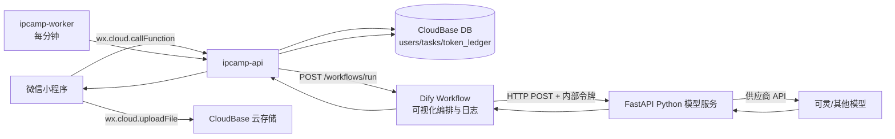
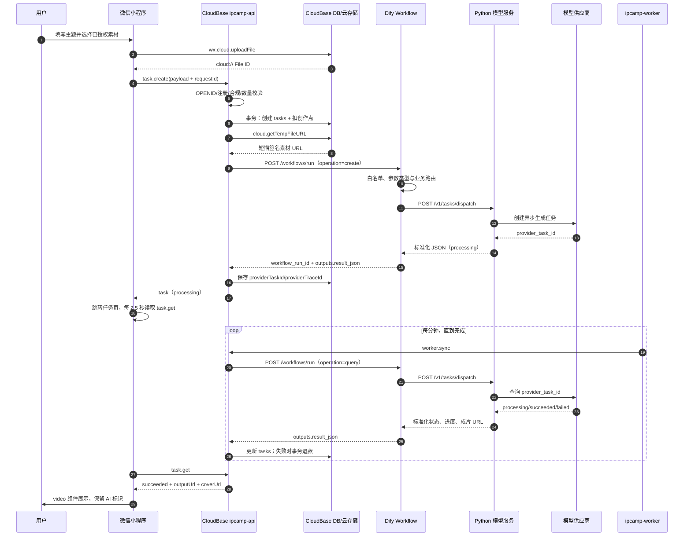

# 超级 IP 创造营：Dify 接入设计与部署方案

版本：基于小程序源码 `0.4.2`，设计日期：2026-08-24。

## 1. 结论

采用“保留 CloudBase 业务后端，替换 AI Provider”的最小侵入方案：

- 小程序页面、云存储上传、微信身份、账户、创作点、订单、任务表和轮询页面全部复用。
- `ipcamp-api` 继续是唯一面向小程序的可信 API，不允许小程序直接调用 Dify。
- 在现有 `lib/providers` 中新增 `DifyProvider`，通过 `VIDEO_PROVIDER=dify` 启用；原 `kling-direct` 保留为一键回滚路径。
- Dify 只负责可视化编排、运行日志和版本管理，不承担长时间等待视频生成。
- Dify 的 HTTP 请求节点调用独立 FastAPI 服务；Python 服务负责模型供应商协议、模型密钥和返回值归一化。
- 原 `ipcamp-worker` 每分钟轮询任务的机制继续使用，但轮询路径改为 `CloudBase → Dify → Python → 模型供应商`。

这避免了重写前端或计费逻辑，也避免将 Dify Key、Python 内部令牌或模型 Key 暴露给微信客户端。

## 2. 源码审计结果

### 2.1 现有可复用链路

| 层 | 现有实现 | 复用结论 |
|---|---|---|
| 小程序调用封装 | `miniprogram/utils/api.js` 的 `call()`、`createTask()`、`getTask()` | 原样保留 |
| 创作表单 | `pages/create/index.js` | 原样保留 |
| 素材上传 | `wx.cloud.uploadFile`，返回 `cloud://` File ID | 原样保留 |
| 服务端入口 | `cloudfunctions/ipcamp-api/index.js` 的 action router | 原样保留 |
| 鉴权与合规 | OPENID、注册校验、授权确认、AI 标识、关键词限制 | 原样保留 |
| 幂等与扣点 | `requestId → taskId`，事务内扣点与 ledger | 原样保留 |
| 失败退款 | `refundTask()` | 原样保留 |
| 异步任务 | `tasks` 集合、`ipcamp-worker` 定时触发 | 原样保留 |
| 小程序展示 | `pages/task/index.js` 每 2.5 秒查询，`video` 展示 `outputUrl` | 原样保留 |
| 模型抽象 | `lib/providers/index.js` + provider 的 `create/query` 接口 | 插入 Dify 的最佳位置 |

### 2.2 发现的结构差异

1. 前端目录定义 5 个业务工作流，但后端 `catalog.js` 只有 4 个；`fitness-diary` 与 `talking-script` 缺少后端计费/校验配置。
2. 当前只有 `viral-film` 前后端都启用，其余功能保持关闭是正确的，不能因接入 Dify 自动开放。
3. 当前项目没有 Python 源码，因此“Python 模型”需要新增独立服务，而不是修改小程序页面。
4. `cloudbaserc.json` 使用 Node.js 16.13，而根 `package.json` 声明 Node.js >=18。现有代码仍能运行，但下次 CloudBase 运行时升级应统一到平台支持的 LTS 版本。

### 2.3 工作流清单

| workflow_id | 前端状态 | 后端状态 | Dify 路由 | 当前 Python 支持 |
|---|---:|---:|---|---|
| `viral-film` | 开放 | 开放 | 图生视频创建/查询 | `kling-direct`、`mock` |
| `same-style` | 关闭 | 关闭 | 已预留 | 待视频编辑模型适配 |
| `ip-avatar` | 关闭 | 关闭 | 已预留 | 待多参考图一致性适配 |
| `fitness-diary` | 关闭 | 后端缺失 | 已预留 | 待补 catalog 与模型模板 |
| `talking-script` | 关闭 | 后端缺失 | 已预留 | 建议后续改为 Dify LLM 节点 |

## 3. 目标架构



信任边界：

- 小程序只信任 CloudBase；无 Dify Key、模型 Key、内部令牌。
- CloudBase 只保存 Dify App API Key。
- Dify 只保存 Python 服务地址和内部令牌。
- Python 服务只保存模型供应商 Key。

## 4. 完整数据流



### 4.1 小程序 → CloudBase

现有 `task.create` 请求继续使用：

```json
{
  "workflowId": "viral-film",
  "topic": "30 天训练变化",
  "audience": "关注个人成长与健身的人群",
  "platform": "小红书",
  "style": "真实纪实",
  "ratio": "9:16",
  "resolution": "720p",
  "duration": 10,
  "sourceType": "self-owned",
  "authorized": true,
  "aiDisclosure": true,
  "images": ["cloud://.../first.jpg"],
  "video": "",
  "requestId": "1724480000000_abcd"
}
```

CloudBase 负责把 `cloud://` 转成短期 HTTPS 地址，再调用 Dify。OPENID、手机号、余额、订单信息不得发送到 Dify。

### 4.2 CloudBase → Dify Workflow API

请求：

```http
POST https://api.dify.ai/v1/workflows/run
Authorization: Bearer ${DIFY_WORKFLOW_API_KEY}
Content-Type: application/json
```

```json
{
  "inputs": {
    "operation": "create",
    "workflow_id": "viral-film",
    "client_business_id": "CloudBase task id",
    "provider_task_id": "",
    "director_prompt": "现有 buildDirectorPrompt 的输出",
    "images_json": "[\"https://signed-temp-url\"]",
    "video_url": "",
    "aspect_ratio": "9:16",
    "resolution": "720p",
    "duration": 10,
    "remove_audio": true
  },
  "response_mode": "blocking",
  "user": "ipcamp:<CloudBase task id>"
}
```

Dify Workflow API 的每次调用是独立运行；blocking 模式只等待“创建模型任务”或“查询一次状态”，不等待视频生成。Dify 官方文档说明 blocking 请求存在 100 秒 Cloudflare 超时，因此本方案将 Python HTTP read timeout 固定为 50 秒，CloudBase Dify 请求为 95 秒。参考：<https://docs.dify.ai/en/api-reference/workflow-runs/run-workflow>。

### 4.3 Dify Workflow 节点

导入文件：`dify/ipcamp-ai-router.yml`。

1. **小程序任务请求（Start）**：定义固定输入契约。
2. **业务工作流路由与请求构建（Code/Python）**：校验 `operation` 和业务工作流白名单，将 `images_json` 转回数组，输出 `request_json` 与可观测的 `route`。
3. **HTTP 请求 → Python 模型（HTTP Request）**：HTTPS POST `/v1/tasks/dispatch`，使用 `X-Internal-Token`，开启 3 次短间隔重试。
4. **标准化结果（End）**：输出 `result_json`、`http_status`、`route`。

Dify HTTP 节点支持变量替换、超时、重试和独立响应字段，参考：<https://docs.dify.ai/en/cloud/use-dify/nodes/http-request>。

### 4.4 Dify → Python

```http
POST https://<model-service-domain>/v1/tasks/dispatch
X-Internal-Token: ${MODEL_SERVICE_TOKEN}
Content-Type: application/json
```

创建请求示例：

```json
{
  "operation": "create",
  "workflow_id": "viral-film",
  "client_business_id": "task id",
  "director_prompt": "...",
  "images": ["https://signed-temp-url"],
  "video_url": null,
  "aspect_ratio": "9:16",
  "resolution": "720p",
  "duration": 10,
  "remove_audio": true
}
```

查询请求只需 `operation=query` 和 `provider_task_id`；为了保持 Dify Start 契约稳定，其余字段由 CloudBase 传空值或默认值。

### 4.5 Python 标准响应

```json
{
  "ok": true,
  "data": {
    "provider_task_id": "provider-task-123",
    "status": "processing",
    "progress": 20,
    "raw_state": "submitted",
    "provider_model": "kling-3.0-turbo",
    "output_url": "",
    "cover_url": "",
    "error_message": ""
  }
}
```

状态只允许 `queued | processing | succeeded | failed`。CloudBase 仍是任务状态和退款结果的最终事实源。

## 5. 修改后的目录结构

```text
超级IP创造营小程序_完整可提交版_0.4.2/
├─ miniprogram/                         # 原小程序，保持不变
│  ├─ app.js / app.json / app.wxss
│  ├─ config.js
│  ├─ assets/creator-studio-open-source.jpg
│  ├─ components/workflow-card/index.{js,json,wxml,wxss}
│  ├─ data/
│  │  ├─ questions.js
│  │  └─ workflows.js
│  ├─ pages/
│  │  ├─ about/ agreement/ create/ games/ home/ login/
│  │  ├─ party/ profile/ quiz/ task/ wallet/ works/
│  │  └─ 每个页面包含 index.{js,json,wxml,wxss}
│  └─ utils/api.js, format.js, mock.js, privacy.js, validator.js
├─ cloudfunctions/
│  ├─ ipcamp-api/
│  │  ├─ index.js                       # 仅增加 workflowId/trace 字段
│  │  ├─ config.json / package.json
│  │  └─ lib/
│  │     ├─ catalog.js / compliance.js / http.js / prompt.js / questions.js
│  │     └─ providers/
│  │        ├─ index.js                 # 增加 VIDEO_PROVIDER=dify
│  │        ├─ dify.js                  # 新增：Dify Workflow API 适配器
│  │        ├─ kling-direct.js / kling.js / toapis.js / vidu.js / mock.js
│  ├─ ipcamp-worker/                    # 原定时轮询机制不变
│  └─ ipcamp-pay-callback/              # 支付链路不变
├─ python-model-service/                # 新增：独立 Python 模型服务
│  ├─ app/
│  │  ├─ main.py / config.py / schemas.py / service.py / graph.py
│  │  └─ providers/base.py, mock.py, kling.py
│  ├─ langgraph.json / pyproject.toml    # LangSmith Deployment 配置
│  ├─ Dockerfile
│  ├─ requirements.txt
│  ├─ .env.example
│  └─ README.md
├─ dify/
│  ├─ ipcamp-ai-router.yml              # 可导入 Dify 的 Workflow DSL
│  └─ README.md
├─ tests/
│  ├─ 原项目测试
│  └─ dify-provider.test.js             # 新增 Dify 契约测试
├─ scripts/                             # 原校验与冒烟脚本
├─ CloudBase环境变量示例.md             # 增加 Dify 配置
├─ Dify接入设计与部署方案.md             # 本文档
├─ cloudbaserc.json / project.config.json / package.json
└─ 原部署、提审、修改说明文档
```

## 6. 部署方案

### 阶段 A：Python 服务 Mock 联调

1. 构建 `python-model-service/Dockerfile`。
2. 部署到腾讯云 CloudBase 云托管、Cloud Run、LangSmith Deployment 或其他具有公网 HTTPS 的容器平台。使用 LangSmith 时，从 GitHub 导入仓库，并把 API 配置路径设为 `python-model-service/langgraph.json`；Dify 仍调用原 `/v1/tasks/dispatch` 自定义 FastAPI 路由，不需要改请求契约。
3. 环境变量：

```text
MODEL_SERVICE_TOKEN=<至少 32 字节随机值>
MODEL_PROVIDER=mock
KLING_API_KEY=
KLING_API_BASE_URL=https://api-beijing.klingai.com
LANGSMITH_TRACING=true
LANGSMITH_PROJECT=super-ip-camp-model-service
```

4. 健康检查：`GET /healthz`，预期 `{"ok":true,"provider":"mock"}`。
5. 不要把 `/docs` 暴露给公网生产环境；在网关层启用限流、请求体大小限制和访问日志脱敏。

### 阶段 B：Dify 草稿联调

1. 在 Dify 工作室导入 `dify/ipcamp-ai-router.yml`。
2. 设置 Workflow 环境变量：

```text
MODEL_SERVICE_BASE_URL=https://<python-service-domain>
MODEL_SERVICE_TOKEN=<与 Python 服务完全相同>
```

3. 先 Test Run：
   - create：`workflow_id=viral-film`，使用测试用 HTTPS 图片地址。
   - query：填入 create 返回的 `provider_task_id`。
4. 确认 End 节点的 `result_json` 是标准响应。
5. 发布 `v1.0.0-mock`。Dify 的 Draft 与 Latest Version 分离；只有发布后的 Workflow 能被 App API 调用。参考：<https://docs.dify.ai/en/cloud/use-dify/build/version-control>。

### 阶段 C：CloudBase 接入 Dify

CloudBase `ipcamp-api` 和 `ipcamp-worker` 配置相同的 AI 路由环境变量：

```text
VIDEO_PROVIDER=dify
DIFY_WORKFLOW_API_KEY=<Dify App API Key>
DIFY_API_BASE_URL=https://api.dify.ai/v1
DIFY_ALLOWED_HOSTS=api.dify.ai
DIFY_USER_PREFIX=ipcamp
WORKER_TOKEN=<保留现有值>
```

重新部署顺序：

1. `ipcamp-api`
2. `ipcamp-worker`
3. 不需要重新部署 `ipcamp-pay-callback`
4. 小程序前端无需为 Dify 修改，也无需重新配置服务器域名，因为仍只调用 `wx.cloud`。

### 阶段 D：切换真实模型

Python 服务环境变量改为：

```text
MODEL_PROVIDER=kling-direct
KLING_API_KEY=<真实 Key>
```

先用测试账号创建一个 `viral-film`，检查：

- CloudBase 只扣一次创作点；
- Dify 日志有 `create:viral-film`；
- Python 返回真实 provider task ID；
- worker 每分钟产生 query 运行日志；
- 成功后 `outputUrl` 可在小程序 `<video>` 播放；
- 失败时退款 ledger 只产生一次；
- 小程序全程保留“AI 生成”标识。

## 7. 回滚方案

无需撤销数据库或前端代码：

```text
VIDEO_PROVIDER=kling-direct
KLING_API_KEY=<原 CloudBase Key>
```

重新部署 `ipcamp-api` 和 `ipcamp-worker` 即回到原模型直连链路。已在处理中的 Dify 任务应先等待完成或单独处理，避免同一批任务由不同 provider 查询。

## 8. 安全、隐私与运维建议

1. **密钥分层**：小程序无密钥；CloudBase 仅 Dify Key；Dify 仅内部令牌；Python 仅模型 Key。
2. **域名白名单**：`DifyProvider` 默认只接受 `api.dify.ai`；自建 Dify 必须显式增加 `DIFY_ALLOWED_HOSTS`。
3. **用户身份最小化**：传给 Dify 的 `user` 是 CloudBase task ID，不是 OPENID、手机号或昵称。
4. **素材数据**：Dify 运行输入会包含短期签名素材 URL 和提示词，并可能出现在 Dify 日志中。上线前应在隐私政策中披露 Dify/Python/模型供应商的处理链，并核对 Dify Cloud 的日志留存与数据处理地域。
5. **短期 URL**：Python 创建模型任务必须在 CloudBase 临时 URL 失效前让模型供应商完成素材抓取；若供应商异步抓取较慢，应改为 Python 服务先转存到受控对象存储。
6. **日志脱敏**：Python 与 LangSmith 不记录完整素材 URL、Authorization、内部令牌、提示词正文或结果 URL；只记录操作类型、工作流、模型供应商、耗时、状态和进度。
7. **超时与重试**：只对网络错误、429、5xx 重试；创建请求依赖 `client_business_id` 幂等，防止供应商被重复扣费。
8. **监控指标**：创建成功率、轮询失败率、P95 创建耗时、生成耗时、失败退款率、Dify workflow_run_id 与 CloudBase task ID 的关联。
9. **工作流版本**：生产调用 Latest Version；每次改动先 Test Run，再发布命名版本并记录回滚版本。
10. **开放顺序**：只开放 `viral-film`；另外 4 个工作流必须完成后端 catalog、模型契约、合规测试和成本校验后逐个启用。

## 9. 验收清单

- [ ] 原项目 `npm test` 全部通过。
- [ ] `npm run check` 通过。
- [ ] Python 镜像健康检查通过。
- [ ] Dify DSL 导入后显示 4 个节点、3 条边。
- [ ] Dify Mock create/query Test Run 通过。
- [ ] Workflow 已发布，App API Key 仅存在 CloudBase。
- [ ] CloudBase `VIDEO_PROVIDER=dify`。
- [ ] 小程序创建任务、任务页轮询和作品页无回归。
- [ ] 真实模型成功生成并播放。
- [ ] 真实模型失败能且只能退款一次。
- [ ] Dify/Python/模型供应商数据处理已写入隐私披露。
- [ ] 回滚到 `kling-direct` 已演练。

## 10. 已完成的本地验证

- Node 测试：26/26 通过。
- 项目结构与 JS 语法检查：通过。
- Python 模块：`compileall` 通过。
- Dify DSL：YAML 解析通过，包含 4 个节点。

尚需外部环境才能完成的验证：Python 容器部署、Dify Test Run、真实模型调用、CloudBase 环境变量与云函数发布。
